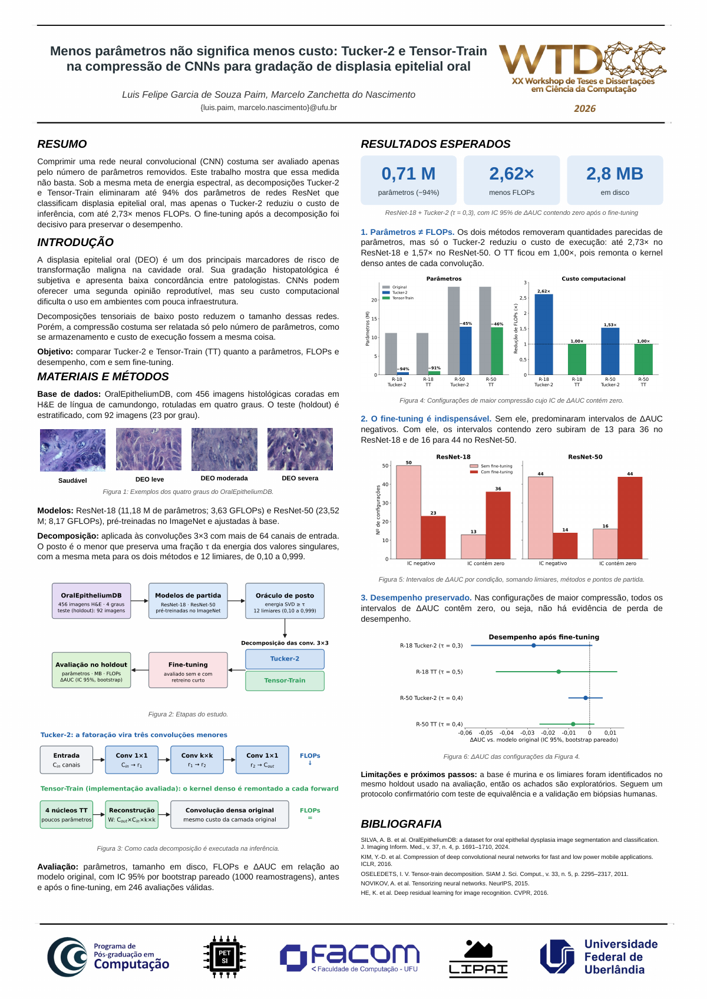

# Tucker-2 × Tensor-Train para compressão de CNNs em histopatologia oral

> **EN —** Low-rank compression of ResNet-18/50 for 4-class ordinal grading of oral epithelial dysplasia (healthy → severe). Tucker-2 and Tensor-Train decompositions are compared under the same protocol: SVD-energy rank selection, same baseline checkpoints, same split, same fine-tuning and same metrics. Code and per-run result CSVs are included; dataset and weights are not.

Comparação controlada entre **Tucker-2** e **Tensor-Train (TT)** para comprimir ResNet-18 e ResNet-50 treinadas na gradação de displasia epitelial oral (4 classes ordinais: *healthy, mild, moderate, severe*). Os dois métodos compartilham tudo, menos a função de decomposição: mesma heurística de rank por energia do SVD, mesmos checkpoints de baseline, mesmo split, mesmo fine-tuning e mesmas métricas.

Pesquisa de iniciação científica na FACOM/UFU. Uma versão deste trabalho recebeu o Prêmio Sérgio de Mello Schneider de Melhor Pesquisa no WTDCC 2026.

## Pôster (WTDCC 2026)

<a href="docs/poster_wtdcc_2026.pdf"></a>

[PDF](docs/poster_wtdcc_2026.pdf) · [PowerPoint editável](docs/poster_wtdcc_2026.pptx)

## O que está sendo comparado

| | Tucker-2 (`src/tucker_compressor.py`) | Tensor-Train (`src/tensor_train_decomposer.py`) |
|---|---|---|
| Decomposição | Modos de canal (C_out, C_in); kernel espacial intacto | 4 núcleos TT sobre o tensor de pesos completo |
| Forward | 3 convoluções reais em sequência: 1×1 → K×K → 1×1 | Reconstrói o kernel denso e aplica uma única convolução |
| Efeito | Reduz parâmetros **e** FLOPs | Reduz parâmetros; FLOPs iguais aos do modelo original |

Camadas elegíveis nos dois casos: convoluções 3×3, sem grupos, com `in_channels > 64`. O rank de cada camada é o menor que retém a fração de energia pedida (12 limiares, de 0.1 a 0.999).

## Protocolo

1. **Baselines** (`notebooks/training/`): ablação de schedulers (CosineAnnealingLR, OneCycleLR, ReduceLROnPlateau) × 7 seeds, validação cruzada de 5 folds com ensemble no teste, mais variantes *holdout*, *sem ensemble* e *Optuna* (HPO por combinação scheduler × seed). Checkpoint escolhido por métrica clínica composta (QWK − taxa de erro perigoso − taxa de subestimação).
2. **Sweep de decomposição** (`notebooks/decomposition/`): para a melhor seed de cada scheduler, aplica Tucker-2 e TT em cada limiar, com e sem fine-tuning (15 épocas, AdamW, early stopping).
3. **Medições por ponto**: parâmetros, tamanho em disco, GFLOPs (hooks), latência com warmup e sincronização CUDA, erro de reconstrução por camada, F1 macro, AUC OvR macro com IC 95% por bootstrap e ΔAUC pareado contra o baseline.

## Resultados (resumo)

Médias sobre os 3 schedulers, baselines da rodada Optuna, **com fine-tuning**. Tabelas geradas de `results/decomposition/decomposition_sweep_pareto_*_optuna.csv`.

**ResNet-18** — baseline: 11.18 M parâmetros, 3.627 GFLOPs, AUC média 0.939

| Método | Limiar de energia | Parâmetros (M) | Compressão | Redução de GFLOPs | Speedup (GPU, batch 1) | AUC teste | ΔAUC |
|---|---|---|---|---|---|---|---|
| Tucker-2 | 0.7 | 2.64 | 4.21× | 2.01× | 1.11× | 0.951 | +0.012 |
| Tucker-2 | 0.8 | 3.94 | 2.82× | 1.73× | 1.28× | 0.941 | +0.002 |
| Tucker-2 | 0.9 | 6.32 | 1.76× | 1.37× | 1.32× | 0.937 | -0.002 |
| Tucker-2 | 0.95 | 8.52 | 1.31× | 1.16× | 1.37× | 0.947 | +0.008 |
| Tensor-Train | 0.7 | 1.84 | 6.01× | 1.00× | 0.78× | 0.944 | +0.005 |
| Tensor-Train | 0.8 | 2.76 | 4.02× | 1.00× | 0.83× | 0.942 | +0.003 |
| Tensor-Train | 0.9 | 4.46 | 2.49× | 1.00× | 0.74× | 0.928 | -0.011 |
| Tensor-Train | 0.95 | 6.34 | 1.76× | 1.00× | 0.76× | 0.932 | -0.006 |

**ResNet-50** — baseline: 23.52 M parâmetros, 8.174 GFLOPs, AUC média 0.975

| Método | Limiar de energia | Parâmetros (M) | Compressão | Redução de GFLOPs | Speedup (GPU, batch 1) | AUC teste | ΔAUC |
|---|---|---|---|---|---|---|---|
| Tucker-2 | 0.7 | 14.53 | 1.62× | 1.40× | 0.82× | 0.975 | -0.000 |
| Tucker-2 | 0.8 | 15.81 | 1.48× | 1.32× | 0.81× | 0.973 | -0.002 |
| Tucker-2 | 0.9 | 18.25 | 1.29× | 1.19× | 0.78× | 0.968 | -0.007 |
| Tucker-2 | 0.95 | 20.66 | 1.14× | 1.08× | 0.81× | 0.978 | +0.003 |
| Tensor-Train | 0.7 | 13.79 | 1.70× | 1.00× | 0.68× | 0.971 | -0.004 |
| Tensor-Train | 0.8 | 14.61 | 1.61× | 1.00× | 0.68× | 0.972 | -0.003 |
| Tensor-Train | 0.9 | 16.62 | 1.41× | 1.00× | 0.65× | 0.978 | +0.003 |
| Tensor-Train | 0.95 | 19.39 | 1.21× | 1.00× | 0.61× | 0.978 | +0.003 |

Leitura:

- A Tucker-2 é a única das duas que reduz GFLOPs; a TT, como implementada aqui, mantém o custo de uma convolução densa e fica mais lenta que o original em GPU.
- Menos GFLOPs não virou sempre menos latência: com batch 1 na GPU, a Tucker-2 acelera a ResNet-18 (1.1–1.4×), mas fica mais lenta que o original na ResNet-50 (~0.8×).
- Na ResNet-50 a compressão é menor porque boa parte dos parâmetros está em convoluções 1×1, que não são decompostas.
- Limiares de energia ≥ 0.99 aumentam o modelo em vez de comprimir (linhas com `status = inchou` nos CSVs).
- Cada ponto vem de um único fold e uma seed por scheduler; trate diferenças pequenas de AUC como ruído (veja `sig`, `d_lo`, `d_hi` nos CSVs).

## Estrutura

```
src/                       módulos de decomposição (Tucker-2 e Tensor-Train)
scripts/                   sweep Tucker isolado e quantização pós-Tucker (fp16 / INT8 PTQ)
docs/                      pôster do WTDCC 2026 (PDF, PPTX e prévia)
notebooks/training/        baselines e ablação de schedulers (ResNet-18/50)
notebooks/decomposition/   sweeps Tucker × TT (baseline fixo ou Optuna; com FT ou *_no_ft)
results/decomposition/     uma linha por (método, limiar, scheduler, seed) + sumários
results/ablation/          logs das ablações e trials do Optuna
results/latency/           comparação de latência para 1 imagem
results/legacy/            primeiras rodadas (sweep TT inicial, quantização, estudo Optuna)
```

## Como reproduzir

```bash
pip install -r requirements.txt
```

1. Obtenha o OralEpitheliumDB com os autores do dataset e coloque as imagens em `Originais/{healthy,mild,moderate,severe}/` na raiz do repositório. O dataset **não** é distribuído aqui.
2. Abra os notebooks com a **raiz do repositório como diretório de trabalho** (no VS Code: `"jupyter.notebookFileRoot": "${workspaceFolder}"`).
3. Rode um notebook de `notebooks/training/` — ele grava checkpoints e o log em `ablation_schedulers_<arquitetura>_..._ckpt_clinical_composite/`.
4. Rode o notebook correspondente de `notebooks/decomposition/`. Os CSVs são escritos na raiz, com *resume*: combinações já gravadas são puladas.

Os scripts em `scripts/` importam de `src/` (`PYTHONPATH=src python scripts/tucker_finetune_sweep.py`).

Experimentos rodados em uma RTX 3050 Laptop (6 GB de VRAM).

## Limitações conhecidas

- Os logs de ablação de algumas variantes (ResNet-18 holdout/sem ensemble/Optuna e ResNet-50 holdout) não estão em `results/ablation/`.
- Pesos treinados não acompanham o repositório.

## Referências

- Y.-D. Kim et al., *Compression of Deep Convolutional Neural Networks for Fast and Low Power Mobile Applications*, ICLR 2016.
- I. V. Oseledets, *Tensor-Train Decomposition*, SIAM J. Sci. Comput., 2011.

## Autor

Luis Felipe Garcia de Souza Paim — FACOM/UFU. Orientação: Prof. Marcelo Zanchetta do Nascimento.
